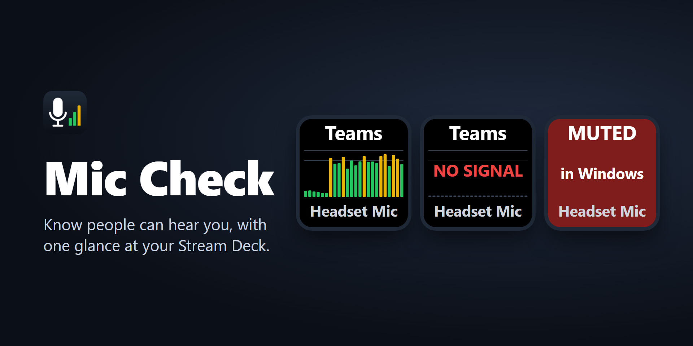

# Mic Check for Stream Deck

A Stream Deck key that shows a live level meter for the microphone your call app is actually using, so you can tell at a glance whether anyone can hear you.



## What it shows

| Key | Meaning |
|---|---|
| **Teams / Discord / Zoom** + scrolling meter | That app is recording. The meter shows the last ~2.5 seconds, and the bottom line names the mic it is using. Other recording apps show their own name. |
| **NO SIGNAL** | An app is recording but receiving perfect digital silence: usually a headset mute switch, an unplugged mic, or a Windows privacy block. |
| **MUTED in Windows** | The mic is muted in Windows. |
| **Input 8%** | The mic's Windows input level is below 20%. |
| **Teams is using _another mic_** | (When the key is locked to one mic) a call app is recording from a different mic. |
| **IDLE / Press to test** | Nothing is recording. Press the key to record for a few seconds and see the meter. |

Windows only measures a microphone while something is recording from it, which is why the key shows IDLE between calls instead of a meter.

## Settings

- **Microphone**: *Auto* (default) follows whichever mic an app is recording from, preferring Teams, Discord and Zoom. You can also lock the key to the Windows default communications mic or to one specific mic.
- **Press to test**: how long a key press records for (5 to 60 seconds).
- **Always listen**: keep the meter live all the time. Windows will show Mic Check as using your microphone.

## Privacy

Mic Check runs entirely on your PC. It reads audio levels and the names of apps that are recording, never stores or sends audio, and makes no internet connections (its only connection is the local one to the Stream Deck app).

## Building

Requirements: Windows 10 or later, the .NET 10 SDK, Visual Studio's C++ build tools (for Native AOT), and Node.js (the Stream Deck CLI runs through `npx`).

```powershell
cd MicCheck
.\build.ps1                    # builds dist\com.bp2008.miccheck.sdPlugin
.\build.ps1 -Pack              # also validates and packs dist\com.bp2008.miccheck.streamDeckPlugin
.\build.ps1 -Pack -Install     # also installs it into Stream Deck (closes and restarts the app)
.\make-marketplace.ps1         # renders the Marketplace thumbnail and gallery images (needs Edge)
```

For development, `MicCheck.exe --console 10 --list` prints what the key would show, and `MicCheck.exe --svg <folder>` writes sample key images for every state.

## How it works

- Core Audio (WASAPI) via source-generated COM interop, compiled with Native AOT into a single ~5 MB exe with no runtime dependency.
- Each active capture endpoint's audio sessions are checked once a second to see which apps are recording from it.
- The endpoint's peak meter is sampled every 20 ms and drawn to the key as an SVG 10 times a second, only when it changes.

## License

[MIT](LICENSE)
